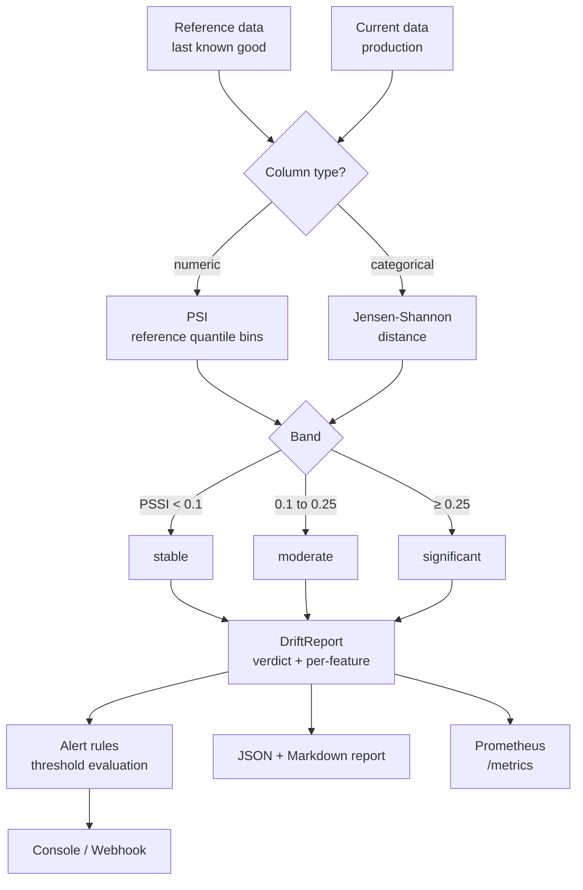

# drift-sentinel

**Detect drift before your users do. Stdlib only.**

Data and LLM drift detection for production systems: Population Stability Index,
Kolmogorov-Smirnov, Jensen-Shannon distance, latency and refusal monitoring,
threshold alerting, and Prometheus export — with zero runtime dependencies.

No numpy, no scipy, no scikit-learn. Pure Python and the standard library.

---

## Why this exists

Drift is the quietest failure mode in machine learning. Nothing throws. The
pipeline stays green. Accuracy quietly decays over three weeks and nobody
notices until a customer escalates.

Most drift tooling either needs a heavyweight dependency stack or only handles
tabular data. This covers both the tabular case *and* the LLM case, and it
installs with nothing but `pip install drift-sentinel`.

The statistics are implemented directly so you can read them. `psi()` is
thirty lines. There is no mystery, and no version-dependent numerical behaviour
between your laptop and your cluster.

## Quick start

No installation needed:

```bash
git clone https://github.com/sajjad-rabby/drift-sentinel.git
cd drift-sentinel
python examples/demo_end_to_end.py
```

Or install it:

```bash
pip install -e .
drift-sentinel --help
```

Requires Python 3.9 or newer. Runtime dependencies: none.

---

## What it measures



### Numeric features: PSI

Population Stability Index measures how far the current distribution has moved
from the reference, using bins cut at the reference's own quantiles.

| PSI | Verdict |
| --- | --- |
| < 0.10 | stable |
| 0.10 – 0.25 | moderate |
| ≥ 0.25 | significant |

Both histograms are smoothed with `EPSILON` before proportions are taken, so a
current sample containing values the reference never had produces a large but
**finite** score instead of an infinity or a division error.

PSI is **directional by design** — the bin edges come from the reference sample,
so swapping the arguments re-bins against the other distribution. The two
values are close but not identical. When you need a symmetric comparison, use
JS distance or KS.

### Categorical features: Jensen-Shannon distance

JS distance is bounded in `[0, 1]`, symmetric, and finite even when the two
samples share no categories at all — properties that matter for a metric you are
going to threshold and alert on.

### Statistical tests

`ks_statistic` and `ks_pvalue` give the two-sample Kolmogorov-Smirnov test for
numeric features where the distributional *shape* matters more than the
binned shape. The p-value uses the standard asymptotic series with the Stephens
small-sample correction.

> The asymptotic approximation is not reliable on very small samples. With
> n = m = 3 it can still return p < 0.05. Treat it as a trend, not a verdict,
> below a few hundred rows.

---

## LLM monitoring

The failure mode for LLM systems is not numeric drift — it is behavioural. Models
get slower, start refusing, drift in tone, or quietly get more expensive.

```python
from drift_sentinel import compute_llm_metrics

metrics = compute_llm_metrics(entries, reference_response="expected answer")
```

Given a JSONL log of calls, you get:

- **latency** — count, min, mean, p50, p90, p99, max
- **refusal rate** — share of responses matching known refusal phrases
- **token totals** and **estimated cost** via a per-model price table
- **Jaccard similarity** against a reference response
- **per-model breakdowns**

```jsonl
{"model": "demo-model", "prompt_tokens": 643, "completion_tokens": 183,
 "latency_ms": 1045.2, "response": "Restart the ingestion worker."}
```

---

## Alerting

Alert rules are plain JSON — no rule engine, no threshold service:

```json
[
  {"metric": "refusal_rate", "operator": ">", "threshold": 0.10,
   "message": "Refusal rate above 10%"},
  {"metric": "latency_ms.p90", "operator": ">", "threshold": 1500,
   "message": "p90 latency above 1.5s"}
]
```

Metrics are addressed with dotted paths, so `latency_ms.p90` reaches into the
nested percentile block.

| Operator | Meaning |
| --- | --- |
| `>`, `>=`, `<`, `<=` | numeric comparison |
| `==`, `!=` | numeric or string equality |

Alerts dispatch to the console always, and to a webhook when `url_env` names an
environment variable holding the URL. Retries use exponential backoff.

### CI integration

`--fail-on` turns a verdict into an exit code, so drift can break a pipeline:

```bash
drift-sentinel compare --reference ref.csv --current prod.csv \
    --json --output report.json --fail-on significant_drift
# exit 0 = fine, 2 = drift at or above the gate
```

---

## CLI

```bash
drift-sentinel compare --reference ref.csv --current prod.csv \
    [--bins 10] [--json] [--alerts rules.json] [--fail-on moderate_drift]
drift-sentinel llm --log calls.jsonl [--reference ref.txt] [--price-table p.json]
drift-sentinel report --path report.json
drift-sentinel serve  --path report.json [--host 127.0.0.1] [--port 9108]
drift-sentinel columns --path data.csv
```

Example output:

```console
$ drift-sentinel compare --reference reference.csv --current current.csv
# drift-sentinel report

**Verdict:** `significant_drift`

## Feature drift

| Feature | Type | Metric | Value | Band | p-value |
| --- | --- | --- | --- | --- | --- |
| age | numeric | psi | 0.2377 | moderate | - |
| plan | categorical | js_distance | 0.3066 | significant | - |
| region | categorical | js_distance | 0.4100 | significant | - |
```

### Prometheus

`serve` binds `127.0.0.1:9108/metrics`. Each feature becomes its own gauge:

```console
$ curl localhost:9108/metrics
# HELP drift_age_psi drift age psi
# TYPE drift_age_psi gauge
drift_age_psi 0.237679
# HELP drift_region_js_distance drift region js distance
# TYPE drift_region_js_distance gauge
drift_region_js_distance 0.409991
```

Only numeric leaves are emitted. A drift `verdict` string is skipped, because a
Prometheus gauge sample has to be a number.

---

## Design notes

**Everything is explicit.** No hidden random state, no global thresholds, no
implicit bin count. Every knob is a parameter with a documented default.

**Fails on nonsense, not on surprise.** A numeric column that picks up a text
value in production is compared categorically instead of raising — that is a
signal worth seeing, not a crash. A column too small to support a distribution
estimate is skipped rather than approximated.

**Directional metrics are labelled as such.** PSI asymmetry is documented in the
docstring and in this README, because it is the kind of thing that quietly
misleads people who assume every distance measure is symmetric.

**CI-native.** Exit codes, JSON output, and a Markdown report mean drift detection
belongs in a pipeline, not in a notebook someone runs once.

## Project layout

```
drift_sentinel/
  stats.py         PSI, KS, JS distance, percentiles, binning
  drift.py         column typing and per-feature comparison
  llm_monitors.py  latency, refusals, tokens, cost, similarity
  alerts.py        rules, operators, console/webhook dispatch
  csv_io.py        CSV read/write with typed coercion
  report.py        JSON and Markdown report builders
  prometheus.py    exposition format and scrape server
  cli.py           drift-sentinel entry point
examples/
  reference.csv, current.csv       datasets with planted drift
  llm_log.jsonl                    healthy LLM call log
  llm_log_degraded.jsonl           refusals + latency regression
  alert_rules.json
tests/              178 offline tests
```

## Testing

```bash
python -m pytest tests
```

178 tests, fully offline, covering percentile interpolation, bin boundaries,
PSI smoothing, KS bounds and p-value behaviour, JS symmetry and disjoint
support, column typing, alert operators, tamper-free CSV round-trips, report
rendering, Prometheus escaping, and the whole CLI.

## License

MIT © 2026 Sajjad Rabby